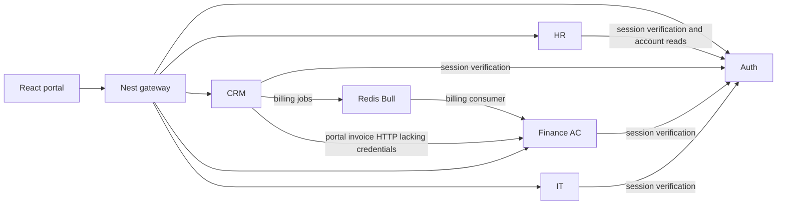

# Actual dependency map and sequence

Status: OBSERVED graph; proposed changes unapproved.

Evidence: gateway proxy config; shared JWT strategy; HR EmployeeAccessService; CRM service; AC billing consumer. Auth owns its own session validation. Every database-enabled domain uses its own Prisma client.

Important journeys: portal employee read needs gateway + HR + Auth + HR database; winning a deal needs CRM persistence + queue + AC consumer + Finance persistence. Finance portal read is currently missing an authenticated interservice contract. Synchronous auth checks introduce availability/latency coupling with a 3-second deadline. No traffic measurements exist.

Proposed sequence: Phase 01 foundation/access -> Phase 02 minimum shared capabilities -> Phase 03 HR integrity/payroll -> Phase 04 Finance reliability -> subsequent pack domains only when source/outcomes are available. Existing CRM/AC remain in place during earlier work. Urgent financial corrections can be separately authorized without inventing a new service or silently changing phase order.

Add no new deployable service, RabbitMQ, cache, or HTTP loop for co-deployed modules. Redis already has a billing use case; durable publication/deduplication remain missing. Pool budget must sum every process/replica/worker, reserving migration and maintenance connections; values remain unknown until hosting capacity is confirmed.
